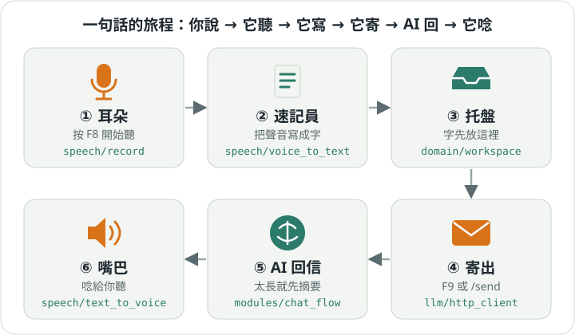

# Voice Client 入門手冊

> 用「講給五歲小孩聽」的方式介紹 Voice Client。想看有圖的網頁版，用瀏覽器打開同資料夾的
> [index.html](index.html)；要查完整細節，看[使用手冊](../user_manual.md)。

## 它是什麼？

Voice Client 是一個**會聽、會寫、會幫你寄信給 AI、還會把回信唸出來**的小幫手。

你不用打字。按一下鍵盤上的 F8，對著麥克風說話，再按一下，你說的話就變成文字。
文字先放進一個「托盤」，等你準備好就寄給 AI。AI 回信後，小幫手會唸給你聽。

想像一間小辦公室：

- **耳朵**負責聽（錄音）。
- **速記員**把聽到的聲音寫成字（語音辨識，STT）。
- **托盤**放著寫好的字，等你決定要不要寄（工作區）。
- **信差**把托盤裡的字寄給 AI（LLM）。
- **嘴巴**把 AI 的回信唸出來（語音合成，TTS）。

## 章節

照順序讀，大約十分鐘就能上手：

1. [準備與第一次開機](md/01-setup.md)：要裝什麼、怎麼啟動。
2. [說話變文字](md/02-talk.md)：五顆魔法鍵和三個托盤。
3. [寄給 AI、聽它回答](md/03-ai.md)：寄出、朗讀、摘要。
4. [用指令和對話筆記本](md/04-commands.md)：斜線指令、用嘴下指令、多段對話。
5. [用手機](md/05-mobile.md)：手機當麥克風和螢幕。
6. [卡住了怎麼辦](md/06-help.md)：常見狀況與解法。
7. [它裡面怎麼運作](md/07-inside.md)：給想改程式的人。

## 一張小抄

| 我想要… | 這樣做 |
|---|---|
| 說話變文字 | 按 F8 說話，再按 F8 |
| 把文字寄給 AI | 按 F9，或打 `/send` |
| 叫它別唸了 | 按 F10，或打 `/stop` |
| 再聽一次 AI 的原文 | 按 F6 |
| 看托盤裡有什麼 | 打 `/show` |
| 忘記指令 | 打 `/help` |
