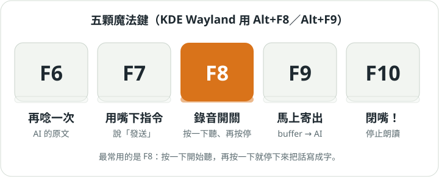
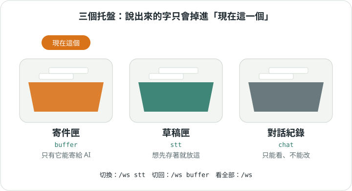

# 2. 說話變文字

[入門手冊目錄](../README.md)｜上一章：[準備與開機](01-setup.md)｜下一章：[寄給 AI](03-ai.md)

## 五顆魔法鍵



鍵盤最上排的 F6 到 F10 是小幫手的魔法鍵。最重要的是 **F8**：

1. 按一下 F8，狀態列變成「錄音中」——耳朵打開了。
2. 對著麥克風說話。
3. 再按一下 F8，狀態列變成「處理中」——速記員正在寫字。
4. 寫好了，文字出現在畫面上，狀態列回到「待機」。

> 用 KDE Plasma 的 Wayland 桌面時，F8 和 F9 要改按 **Alt+F8**、**Alt+F9**。
> 原因是 Wayland 不讓一般程式偷聽整個鍵盤，所以改由 KDE 的快捷鍵轉告小幫手。
> 設定方法見 [KDE Wayland 全域快捷鍵](../../kde_wayland_shortcuts.md)。

如果你一直沒說話就按停止，它不會白等，會直接回到「待機」。

## 打字也可以

不想說話的時候，直接在下方輸入框打字、按 Enter，效果和用 F8 說話一樣：
那段文字會被放進托盤。開頭是 `/` 的才會被當成指令。

## 三個托盤



說出來（或打出來）的字，不會直接寄給 AI，而是先放進托盤。小幫手有三個托盤：

- **buffer（寄件匣）**：一開機就是用這個。只有它能把內容寄給 AI。
- **stt（草稿匣）**：想先存著、晚點再用的話放這裡。
- **chat（對話紀錄）**：你和 AI 說過的話。只能看，不能改。

最重要的規則：**字只會掉進「現在這一個」托盤**。想把話收進草稿匣，先切過去：

```
/ws stt      ← 換到草稿匣
/ws buffer   ← 換回寄件匣
/ws          ← 看全部托盤，哪個是現在這個
```

## 整理托盤

托盤裡的每一段話都有編號。常用的整理方法：

- `/show`：看托盤裡有什麼。
- `/del 2`：把第 2 段丟掉。
- `/to_top 3`：把第 3 段移到最前面。
- `/concat`：把好幾段黏成一段。
- `/clear`：整個倒掉。

下一章：[寄給 AI、聽它回答](03-ai.md)
