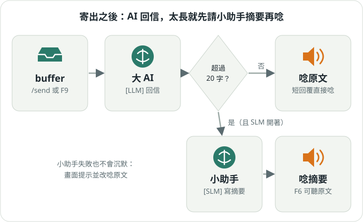

# 3. 寄給 AI、聽它回答

[入門手冊目錄](../README.md)｜上一章：[說話變文字](02-talk.md)｜下一章：[指令與對話](04-commands.md)

## 寄出去

寄件匣（buffer）裡的字準備好了，就寄給 AI：

- 按 **F9**（KDE Wayland 是 Alt+F9），或
- 打 `/send`。

寄出後寄件匣會清空，就像把信投進郵筒。你寄出的話和 AI 的回信都會記到「對話紀錄」（chat）。

> 只有寄件匣能寄。在草稿匣按寄出，小幫手會提醒你「`/send` 僅適用於 buffer 工作區」。

## 它會唸給你聽



AI 回信後，嘴巴（TTS）會把回信唸出來。如果回信很長，一直聽會很累，所以小幫手有個小助手：

1. 回信**超過 20 個字**，而且你在 `config.ini` 打開了 `[SLM] enabled = true`，
   小幫手就先請一個小一點的 AI（SLM）寫摘要，唸摘要給你聽。
2. 回信很短，或沒開小助手，就直接唸原文。
3. 想聽完整原文？按 **F6**。
4. 唸太久不想聽了？按 **F10**，或打 `/stop`。

小助手如果出錯，小幫手不會沉默：畫面會說「摘要失敗」，然後改唸原文。

## 換一個嗓音

在 `config.ini` 的 `[TTS]` 可以換嘴巴：

```ini
[TTS]
engine = kokoro      ; kokoro 比較自然；也可以用 pyttsx3（espeak）
kokoro_voice_zh = zf_001
kokoro_voice_en = af_heart
```

中文和英文會自動分開，用不同的嗓音唸。

下一章：[用指令和對話筆記本](04-commands.md)
