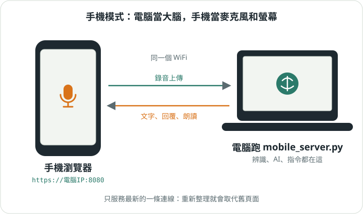

# 5. 用手機

[入門手冊目錄](../README.md)｜上一章：[指令與對話](04-commands.md)｜下一章：[卡住了怎麼辦](06-help.md)



不在電腦前面也能用。這時候**電腦當大腦，手機當麥克風和螢幕**：聽寫、寄信給 AI、整理托盤，
全部還是電腦在做，手機只負責收音、顯示和唸出來。

## 怎麼開

1. 在電腦上啟動手機模式：

   ```bash
   .venv/bin/python mobile_server.py
   ```

2. 終端機會印出一個網址，像 `https://192.168.x.x:8080`。
3. 手機和電腦要連**同一個 WiFi**，用手機瀏覽器打開那個網址。
4. 瀏覽器會警告「連線不安全」。這是因為憑證是電腦自己簽的，點「進階」→「繼續前往」就好。

> 為什麼要 https？手機瀏覽器規定，只有安全連線的網頁才能用麥克風。所以 `[MOBILE] ssl` 建議開著。

## 和電腦版一樣的地方

手機和電腦用的是**同一個大腦**，所以：

- 托盤一樣是 buffer、stt、chat，說的話一樣只進「現在這一個」。
- 斜線指令和回覆文字都一樣。
- `/copy`、`/paste` 用的是手機瀏覽器的剪貼簿。

## 不一樣的地方

- 手機沒有 F 鍵，錄音用畫面上的按鈕。也因此沒有「用嘴巴下指令」模式。
- 沒有 `/exit`：手機不能把電腦上的伺服器關掉。
- 一次只服務一個頁面。重新整理或另開分頁，舊頁面會被斷開，新頁面接手。
- 關掉伺服器時，寄件匣裡還沒寄的字會自動存成 `_buffer_temp.json`，
  下次用 `/import _buffer_temp` 拿回來。

下一章：[卡住了怎麼辦](06-help.md)
