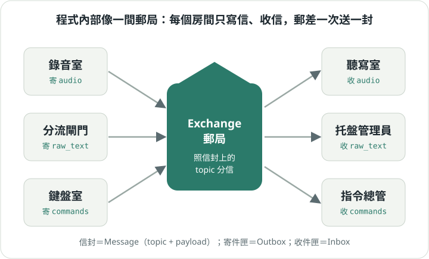

# 7. 它裡面怎麼運作

[入門手冊目錄](../README.md)｜上一章：[卡住了怎麼辦](06-help.md)

這一章給想改程式的人。正式的架構說明在[架構文檔](../../architecture.md)，這裡只講故事。

## 一間郵局



小幫手裡面有很多「房間」（模組）：錄音室、聽寫室、指令總管、聊天流程……
房間之間**從不直接講話**，只寫信：

1. 每個房間有一個**寄件匣**（Outbox）和一個**收件匣**（Inbox）。
2. 要找別人時，把信放進自己的寄件匣。信封上寫著 **topic**（要寄給哪一類收件人），裡面是 **payload**（內容）。
3. **郵差**（Exchange）一次只拿一封信，看信封上的 topic，放進對應房間的收件匣。

這套做法叫 **Data Tunnel（資料隧道）**。好處是：每個房間只要懂信的格式，不必知道別的房間怎麼做事；
所有信都經過同一個郵差，要查問題時只要看郵差的紀錄。

## 信封上的字從哪來

所有 topic 名稱、信的格式和指令清單，都只寫在一個地方：`protocol/`。

- `protocol/topics.py`：有哪些 topic。
- `protocol/payloads.py`：每種信長什麼樣子。
- `protocol/commands.py`：有哪些斜線指令和熱鍵。

有測試會檢查程式、文件和這裡三方一致，改錯就會變紅燈。

## 房間在哪裡

- `speech/`：耳朵、速記員、嘴巴（錄音、STT、TTS）。
- `ui/`：鍵盤、終端輸入、畫面、KDE 快捷鍵入口。
- `llm/`：寄信給 AI、寫摘要。
- `domain/`：托盤和對話筆記本。
- `modules/`：指令總管、聊天流程等原生房間。
- `core/`：郵局本身（Exchange、寄件匣、收件匣）。
- `app_wiring/`：把房間接上郵局；`build_core()` 一次蓋好整棟樓。
- `mobile/`：手機版只換掉門口（瀏覽器取代麥克風和畫面），裡面用同一棟樓。

## 自己探險

想知道誰寄信給誰，不必讀完所有程式，問地圖工具就好：

```bash
python workflows/common/code-map/codemap.py topics      # 每種信：誰寄、誰收
python workflows/common/code-map/codemap.py show modules/chat_flow.py
python workflows/common/code-map/codemap.py deps domain.workspace
```

改完程式記得跑測試：

```bash
.venv/bin/python -m pytest -q
```

導航地圖在 [CODE_MAP](../../../workflows/common/code-map/CODE_MAP.md)。
